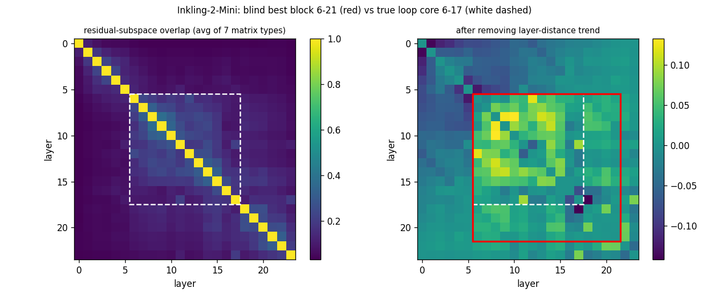
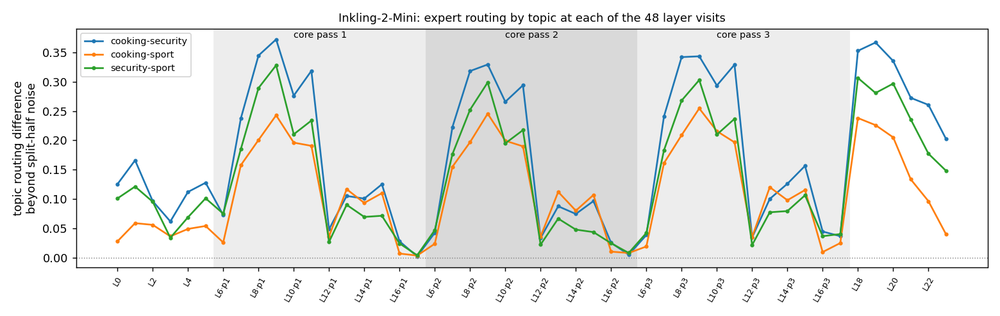

# Finding the loop inside Inkling-2-Mini

Small interpretability experiments on **Inkling-2-Mini**, a looped mixture-of-experts model, run on a MacBook from a quantized GGUF. No GPU rental was needed.

Inkling-2-Mini has 24 physical layers. Layers 0–5 are a prelude, **layers 6–17 form a loop core that runs 3 times with shared weights**, and layers 18–23 are a coda: 48 layer visits per token, 128 experts per MoE layer, 8 active. The GGUF metadata says so (`loop.start=6, loop.end=18, loop.count=3`), which makes this a model with a known ground truth for testing interpretability methods.

## Questions

1. **Weight space:** can a method that only looks at the weights find the loop without being told where it is?
2. **Domains in weight space:** do cybersecurity token directions concentrate in the loop core?
3. **Expert routing:** which layers route by topic (security vs cooking vs sport), and does that change from pass to pass?

## Results

### 1. Weights alone find the start of the loop (`gguf_loop_test.py`)
For each layer and each matrix type, the script takes the top-64 residual-stream subspace and measures subspace overlap between every pair of layers. It removes the generic "neighbouring layers look alike" trend, then searches for the contiguous block with the strongest excess similarity. A layer-shuffling permutation test gives the p-value.

- The **loop start (layer 6) was found blind** in 5 of 7 matrix types (6 of 7 within one layer).
- The **true core 6–17 is more internally similar than chance in all 7 types** (p = 0.002–0.03). `attn_v` recovers 6–17 exactly.
- The **end is fuzzy.** 6–15 is strongly alike, while 16–17 look less core-like.



### 2. Token directions: no domain effect (`domain_test.py`)
About 150 tokens per domain were projected onto each layer's read and write subspaces. Security doesn't load onto the core more than cooking or sport do (best p = 0.11). Raw token directions are a weak probe beyond the first few layers, so this is a null result for this probe only.

### 3. Expert routing splits the core in two (`experts/`)
`llama-imatrix` counts which experts fire on about 512 tokens each of security, cooking and sport text, split into A/B halves. The halves give a noise floor: same-domain differences are subtracted out. Two small patches (in `patches/`) make it record each pass through the loop separately.

- **L7–11: content routing.** Strong topic-specific expert choice, almost identical on every pass (drift between passes ≈ 0.01 JSD).
- **L12–17: loop control?** Barely topic-sensitive on any pass, but routing changes increasingly with the pass. **L17 picks very different experts on each pass** (pass-to-pass JSD 0.36–0.45).
- **Security** differs from the controls most in the prelude (2.1× the cooking-vs-sport gap) and the coda (1.7×), and least in the core (about 1.2–1.3× on every pass).



The weight-space boundary near layers 15–17 and the routing boundary at L12/L17 are independent measurements that point to the same structure.

## Caveats
- One model, and it's a community **abliterated** GGUF (`mrfakename/Inkling-2-Mini-abliterated-GGUF`, UD-Q4_K_XL). Attention weights are Q8_0 and experts are 4-bit. Results should be checked on unmodified weights.
- 512 tokens per text half and one text per domain. The security text is jargon-heavy, so some of the "security" effect may be vocabulary rather than topic.
- JSD-based routing differences show *that* routing changes, not *what* the experts compute.

## Reproduce
Requirements: Python 3 with `numpy` and `matplotlib`, llama.cpp's `gguf-py`, and a llama.cpp checkout with `inkling2_loop` support (for example the one Unsloth installs at `~/.unsloth/llama.cpp`).

```bash
export INKLING_GGUF=/path/to/Inkling-2-Mini-*.gguf
GGUFPY=~/.unsloth/llama.cpp/gguf-py

# 1-2: weight space (CPU, a few minutes)
python gguf_loop_test.py "$INKLING_GGUF" --gguf-py $GGUFPY --out . --only attn_q   # repeat per type, then --combine
python domain_test.py    "$INKLING_GGUF" --gguf-py $GGUFPY --out . --bases attn_q,attn_k,attn_v,ffn_gate_inp,attn_output
python domain_test.py    "$INKLING_GGUF" --gguf-py $GGUFPY --out . --analyze

# 3: expert routing (needs cmake; builds llama-imatrix in experts/llama-build)
cd experts && ./run_experts.sh && python analyze_experts.py $GGUFPY
cd ~/.unsloth/llama.cpp && patch -p1 < /path/to/repo/patches/imatrix-per-visit.patch \
                         && patch -p1 < /path/to/repo/patches/llama-graph-name-moe-matmul.patch
cd - && ./run_experts_perpass.sh && python analyze_perpass.py $GGUFPY
```
The raw expert counts behind the routing plots are in `data/expert_counts.json`.

## Patches
- `imatrix-per-visit.patch`: when `IMATRIX_PER_SLOT=1` is set, records MoE expert usage per layer *visit* (`blk.<visit>.*`) instead of per shared weight. It has no effect otherwise.
- `llama-graph-name-moe-matmul.patch`: labels the expert `mul_mat_id` node with its layer visit. Per-expert scales wrap it in a multiply, which otherwise hides the label. It only sets a name; the computation is unchanged.
